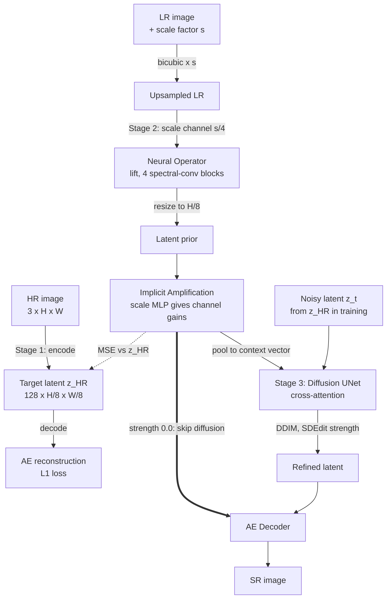
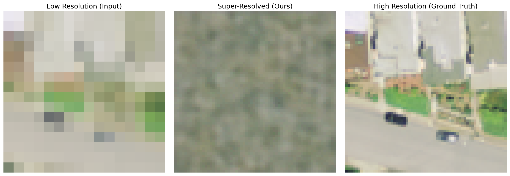
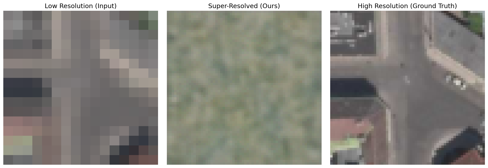
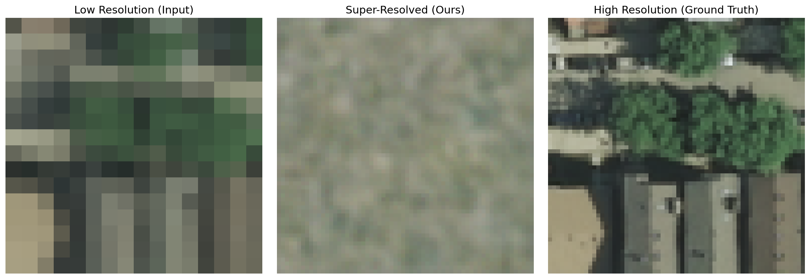
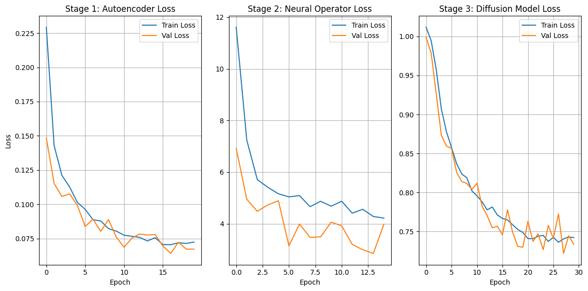

# HNDSR: Hybrid Neural Operator–Diffusion Model for Continuous-Scale Satellite Super-Resolution

[](LICENSE)
[](https://www.python.org/downloads/)
[](https://pytorch.org/)
[](https://huggingface.co/spaces/the-harsh-vardhan/HNDSR-Production)
[](https://hndsr.vercel.app)

A three-stage PyTorch pipeline that combines a **Fourier Neural Operator** (scale-aware global mapping) with a **latent diffusion model** (perceptual detail) to upscale satellite imagery. This repository holds the research code (notebooks, MLflow runs), the audits and the paper; the serving stack lives in the separate [HNDSR-Production](https://github.com/The-Harsh-Vardhan/HNDSR-Production) repo.

**Docs site:** <https://the-harsh-vardhan.github.io/HNDSR/>

> **Honest status.** The paper reports 29.40 dB PSNR / 0.87 SSIM, but this repo's own measured evaluation is **23.48 dB / 0.570** (see [Results](#results)), and the ablation shows the diffusion stage does not yet help. That gap is documented in [`docs/audits/`](docs/audits/03-paper-feasibility-ground-reality.md), not hidden.

## What it does

- Trains an **autoencoder** on high-resolution tiles to get a 128-channel latent at 1/8 spatial resolution.
- Trains a **Fourier Neural Operator** (4 spectral-convolution blocks, scale-conditioned) plus an **implicit amplification** MLP to map a bicubic-upsampled low-resolution image into that latent space.
- Trains a **latent diffusion UNet** conditioned on the operator output, with DDIM sampling and an SDEdit-style strength knob at inference.
- Tracks all three stages with **MLflow** and evaluates PSNR, SSIM and LPIPS on a held-out split of the 4× satellite dataset.
- Documents the bug history and a paper-vs-measured audit in [`docs/audits/`](docs/audits/).

## Architecture

The diagram below follows `MLFlow/HNDSR_MLflow.ipynb` (the `HNDSR` class and the three training cells).



The original paper figures are in [`Images/`](Images/) (`fig-01_final.png`, `fig-02_final.png`) and on the [architecture page](https://the-harsh-vardhan.github.io/HNDSR/architecture).

### Stage 1: Residual autoencoder (E_θ, D_φ)
*   **Purpose**: learn the latent space used by the other two stages.
*   **Architecture**: a 3×3 conv, three stride-2 convolutions (downsample ratio 8, latent width 128) and four `ResidualBlock`s (conv–ReLU–conv); the decoder mirrors it with transposed convolutions and a `Tanh` output.
*   **Loss**: L1 reconstruction.

### Stage 2: Fourier Neural Operator (φ_NO) and implicit amplification
*   **Purpose**: map the bicubic-upsampled LR image to the HR latent, conditioned on the scale factor, so the scale is an input rather than a fixed architectural choice.
*   **Mechanism**: a 1×1 lifting conv (input plus a constant `s/4` scale channel), four spectral-convolution blocks (`rfft2`, learnable complex weights on the lowest 8×8 modes, `irfft2`) each with a 1×1 skip conv and GELU, then a two-layer projection to 128 channels.
*   **Implicit amplification**: an MLP from the scalar scale to per-channel gains (`latent * (1 + gain)`); trained jointly with the operator (the main v2 bug fix).
*   **Loss**: `MSE(ImplicitAmp(φ_NO(I_LR, s)), E_θ(I_HR))`.

### Stage 3: Latent diffusion UNet (ε_θ)
*   **Purpose**: refine the latent with a noise-prediction model.
*   **Conditioning**: the Stage 2 latent is average-pooled to a single 128-d context vector and used through a cross-attention block in the UNet middle (64 base channels).
*   **Sampling**: DDIM over a 1000-step schedule. `diffusion_strength` sets the SDEdit start point: `0.0` skips diffusion and decodes the Stage 2 latent directly; `1.0` starts from pure noise.
*   **Loss**: `E[ ‖ε − ε_θ(z_t, t, c)‖² ]`.

---

## Results

Paper headline numbers are **targets**, not reproduced results. The measured rows come from this repo's notebook outputs (`MLFlow/HNDSR_MLflow.ipynb`).

### SOTA comparison (literature targets)

| Method | PSNR ↑ | SSIM ↑ | LPIPS ↓ | Source |
| :--- | :--- | :--- | :--- | :--- |
| Bicubic | 24.53 | 0.71 | 0.35 | Baseline |
| EDSR | 26.81 | 0.79 | 0.28 | Lim et al. 2017 |
| ESRGAN | 27.14 | 0.81 | 0.24 | Wang et al. 2018 |
| **HNDSR (Target)** | **29.40** | **0.87** | **0.16** | Paper §IV |

### Measured results (local training, 360 satellite image pairs, RTX 4050 6GB)

| Version | PSNR ↑ | SSIM ↑ | LPIPS ↓ | Notes |
| :--- | :--- | :--- | :--- | :--- |
| v1: 20+15+30 epochs (broken) | 15.33 ± 3.52 | 0.278 ± 0.131 | 0.596 ± 0.117 | `implicit_amp` untrained, context mismatch |
| **v3: 50+30+100 epochs (fixed)** | **23.48 ± 3.25** | **0.5700 ± 0.1224** | **0.4809 ± 0.1053** | Bug fixes + SDEdit inference |

> **Bugs fixed in v2/v3:** (1) `ImplicitAmplification` was never included in any optimizer, so it had random weights at inference; (2) diffusion context was computed from raw FNO output during training but from `implicit_amp`-modulated output during inference; (3) diffusion started from pure noise with only a 128-d context vector, insufficient for spatial reconstruction, so inference was switched to SDEdit-style or direct FNO+Amp decoding.

### Diffusion strength ablation (v3)

| `diffusion_strength` | PSNR ↑ | SSIM ↑ | LPIPS ↓ |
| :--- | :--- | :--- | :--- |
| **0.0 (no diffusion)** | **23.19** | **0.5519** | **0.4921** |
| 0.1 (light SDEdit) | 22.85 | 0.5363 | 0.4812 |
| 0.3 | 19.74 | 0.4385 | 0.4979 |
| 1.0 (pure noise) | 13.98 | 0.2212 | 0.6409 |

> The diffusion UNet (64 channels, 1 cross-attention token) lacks the capacity to generate good latents from noise. The FNO + ImplicitAmp pipeline alone produces the best results. The notebook's full sweep (0.0 to 1.0 in 8 steps) is in `MLFlow/HNDSR_MLflow.ipynb`.

## Screenshots

**Saved evaluation outputs** (low-resolution input, model output, ground truth) from the notebook's evaluation cell, `MLFlow/evaluation_results/comparison_*.png` in HNDSR-Production. The outputs are visibly blurry and miss fine structure, which is consistent with the measured 23 dB result above. The notebook does not record which run produced each saved file.





**Per-stage training curves** (autoencoder, neural operator, diffusion; the x-axes show a short 20/15/30-epoch run):



## Quickstart

The research code runs from notebooks; there is no packaged CLI in this repo.

```bash
git clone https://github.com/The-Harsh-Vardhan/HNDSR.git
cd HNDSR
python -m venv .venv && source .venv/bin/activate   # Windows: .venv\Scripts\activate
pip install -r requirements.txt
pip install mlflow jupyter                           # used by the MLflow notebook
jupyter notebook MLFlow/HNDSR_MLflow.ipynb
```

The notebook downloads the [4x satellite image super-resolution](https://www.kaggle.com/datasets/cristobaltudela/4x-satellite-image-super-resolution) dataset through `kagglehub` (HR 0.5 m / LR 2 m pairs). A GPU is strongly recommended. Other notebooks: `HNDSR_Original.ipynb`, `HNDSR_Kaggle.ipynb`, `HNDSR_Databricks_MLflow.ipynb`, `HNDSR_Corrected.ipynb`.

## Production system (HNDSR-Production)

The serving stack was split into [HNDSR-Production](https://github.com/The-Harsh-Vardhan/HNDSR-Production):

| Component | Link |
| :--- | :--- |
| Frontend UI | [hndsr.vercel.app](https://hndsr.vercel.app) |
| Backend API | [Hugging Face Space](https://huggingface.co/spaces/the-harsh-vardhan/HNDSR-Production) |

Engineering notes carried over from the earlier README, as described for that stack (verified to run on an NVIDIA RTX 4050 GPU):

*   **Concurrency**: an `asyncio.Semaphore` bounds concurrent GPU executions, and a singleton `ModelLoader` loads the roughly 12M-parameter weights once.
*   **Large images**: a `SatelliteTileProcessor` splits images into overlapping tiles (e.g. 64x64 or 128x128) and blends them with a Hann window to avoid seams.
*   **Observability**: Prometheus + Grafana for p50/p90/p99 inference latency, VRAM use, and counters for GPU OOM, timeouts and decode failures.

Note that audit [03](docs/audits/03-paper-feasibility-ground-reality.md) found the public API accepts only integer scale factors (2 to 8), so continuous-scale support is an architectural property rather than a validated deployed feature.

## Project structure

```text
HNDSR/
├── MLFlow/                    # MLflow notebook (v2/v3 training) + mlruns + training curves
├── HNDSR_Original.ipynb       # Original research notebook
├── HNDSR_Kaggle.ipynb         # Kaggle variant
├── HNDSR_Databricks_MLflow.ipynb
├── HNDSR_Corrected.ipynb
├── research_tracks/
│   └── hndsr_rebuild/         # Isolated rebuild track: configs, scripts, tests, reports
├── docs/                      # Paper, report, slides, audits (also the Pages site)
├── Images/                    # Paper figures and tables
├── requirements.txt
├── CITATION.bib
└── LICENSE
```

## Tech stack

Python, PyTorch (`torch.fft` for the spectral convolutions), torchvision, LPIPS, scikit-image, MLflow, Weights & Biases (rebuild track), timm, einops, kagglehub, Jekyll (docs site).

## Documentation

- Site: <https://the-harsh-vardhan.github.io/HNDSR/> (overview, architecture, setup, results)
- Paper: [`docs/HNDSR_Paper_Final.pdf`](docs/HNDSR_Paper_Final.pdf), report: [`docs/HNDSR Mini-Project Report.pdf`](docs/HNDSR%20Mini-Project%20Report.pdf), slides: [`docs/5th Sem Mini Project PPT.pdf`](docs/5th%20Sem%20Mini%20Project%20PPT.pdf)
- Audits: [`docs/audits/`](docs/audits/)

## Academic context

**Authors:** Adil Khan, Rakshit Modanwal, Harsh Vardhan, Piyush Jain, Yash Vikram
**Institution:** IIIT Nagpur | **Status:** Unpublished academic mini-project (2025)

## License and citation

Licensed under **MIT** (see [LICENSE](LICENSE)). If you use HNDSR in your research:

```bibtex
@misc{khan2025hndsr,
  title={HNDSR: A Hybrid Neural Operator–Diffusion Model for Continuous-Scale Satellite Image Super-Resolution},
  author={Khan, Adil and Modanwal, Rakshit and Vardhan, Harsh and Jain, Piyush and Vikram, Yash},
  year={2025},
  note={Unpublished Mini-Project, IIIT Nagpur},
  howpublished={\url{https://github.com/The-Harsh-Vardhan/HNDSR}}
}
```

---
**Last Updated:** March 2026 | [The-Harsh-Vardhan](https://github.com/The-Harsh-Vardhan)
